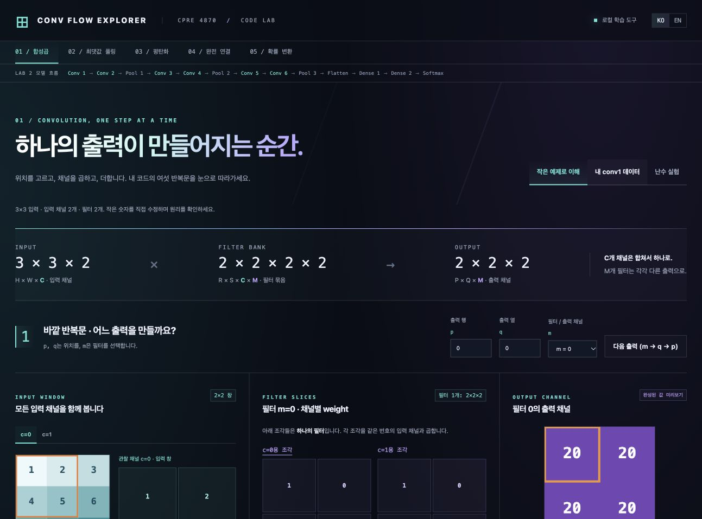

# CPRE 487 Lab Flow Explorer

**신경망에서 값이 각 레이어를 거쳐 어떻게 변하는지, 개념과 코드를 함께 따라가는 인터랙티브 학습 도구입니다.**

Convolution, Max Pooling, Flatten, Dense, Softmax의 역할과 데이터 흐름을 3D 형태의 그림, 작은 숫자 예시, 단계별 계산, 원본 코드로 연결합니다. 이 개념은 특정 수업을 넘어 신경망을 이해하는 데 활용할 수 있으며, 현재 제공하는 실제 수치와 코드 자료는 Iowa State CPrE 487/587의 CNN Lab 프로젝트를 기반으로 합니다.

각 그림에는 공간 위치·채널 수·벡터 길이를 직접 표시했습니다. 사용자는 한 출력값을 선택해 입력에서 다음 레이어의 출력까지 어떤 연산이 일어나는지 실험할 수 있습니다. 다만 현재 구현은 이 CNN의 대표 레이어를 보여주며, 모든 신경망 구조나 모든 은닉층 유형을 실행하는 범용 시뮬레이터는 아닙니다.

[웹에서 바로 실행](https://devjwk.github.io/conv-flow-explorer/) · [English README](README.md)

웹 버전은 설치 없이 브라우저에서 열립니다. 포함된 Lab 데이터와 난수 실험을 사용할 수 있습니다. 원본 Lab 저장소를 새로 복제하거나 검증 데이터를 재생성하려면 아래 로컬 실행 방법을 사용하세요.

## 다른 컴퓨터에서 한 명령으로 시작

이 폴더 전체를 내려받거나 배포 ZIP을 압축 해제한 후 실행합니다. Python 3.9 이상과 Git이 필요하며 Windows, macOS, Linux용으로 표준 라이브러리만 사용합니다. C++ 컴파일러와 Node는 추가 검증용으로 선택 사항입니다.

```bash
cd conv-flow-explorer
python3 run.py
```

Windows에서는 Python 설치 형태에 따라 `py -3 run.py`를 사용할 수 있습니다.

이 명령은 공개 저장소 `devjwk/cpre487lab2`부터 `cpre487lab5`까지 `sources/` 아래에 shallow clone하고, 데이터와 코드 조각을 준비하고, 임의 seed를 선택해 로컬 학습 화면을 기본 브라우저에 엽니다. 첫 실행에는 GitHub 접속과 다운로드 시간이 필요합니다. 이미 복제된 저장소는 현재 checkout을 재사용하며 reset/pull을 하지 않습니다. 데이터 크기가 예상과 다르면 준비를 중단합니다.

똑같은 숫자로 재현하려면:

```bash
python3 run.py --seed 4870
```

화면의 난수 실험 탭에서 seed를 바꾸거나 **새 숫자 배정**을 누를 수 있습니다. 난수 모드는 입력 4×4×3, 필터 2×2×3×3, 출력 3×3×3이며 입력 0–9, weight −2–2, bias −3–3을 사용합니다. 난수 모드는 처음에 출력값의 변화가 가장 잘 보이는 필터를 선택합니다. 다른 필터도 직접 고를 수 있습니다. 출력이 전부 0이면 선택 위치의 ReLU 전 누적합과 0이 된 이유를 표시합니다. 난수 필터는 계산 구조를 보기 위한 값이며 학습된 모델이 아닙니다. xorshift32-v1으로 같은 seed는 같은 초기 숫자를 만듭니다. 값의 수동 수정은 seed에 포함되지 않으므로 다시 같은 seed로 생성하면 초기 숫자로 복원됩니다. 주소의 `?seed=4870`도 같은 난수 예제를 엽니다.

주요 옵션:

```bash
python3 run.py --offline --seed 4870       # 복제 없이 포함된 데이터/코드로 실험
python3 run.py --existing-root .. --seed 4870  # 상위 폴더의 기존 Lab 2–5 재사용
python3 run.py --no-native                # C++ 참조 생성 생략
python3 run.py --port 0                   # 사용 가능한 로컬 포트 자동 선택
python3 run.py --prepare-only             # 준비만 하고 종료
```

표준 실행 포트는 8787이며 Ctrl+C로 서버를 종료합니다. 기존 8765 preview와 별도로 동작합니다. `validation/setup.json`에는 seed와 사용한 저장소 commit이 기록됩니다. 웹 버전은 GitHub Pages에서 제공되며, 로컬 실행은 자신의 컴퓨터에서 실험할 때 사용할 수 있습니다.

## GitHub에서 내려받기

공개된 저장소는 다음 명령어로 내려받아 실행할 수 있습니다.

```bash
git clone https://github.com/devjwk/conv-flow-explorer.git
cd conv-flow-explorer
python3 run.py --offline
```

`--offline`은 포함된 데이터로 바로 실행합니다. `python3 run.py`는 공개 Lab 2–5를 복제하여 데이터를 다시 준비합니다. Lab 1은 현재 비공개이며 이 도구의 실행에는 필요하지 않습니다.

## 한국어 / English

화면 오른쪽 위 **KO / EN**으로 설명, 버튼, 계산 상태, 접근성 레이블을 전환합니다. 언어를 바꿔도 수정한 숫자와 계산 단계는 유지됩니다. 언어 선택은 브라우저에 저장되며 주소의 `?lang=ko` 또는 `?lang=en`으로 지정할 수도 있습니다. 초기 언어는 브라우저 설정을 따릅니다. 코드 원문과 변수 이름은 번역하지 않습니다.

## 열기

Finder에서 `conv-explorer/dist/index.html`을 더블클릭하면 새 메인 화면이 열립니다. 이미 포함된 데이터로는 인터넷 연결과 추가 패키지가 필요하지 않습니다. `dist` 폴더의 파일 전체를 함께 유지하세요.

로컬 서버로 열려면:

```bash
cd conv-explorer
python3 -m http.server 8765 --bind 127.0.0.1
```

브라우저 주소: http://127.0.0.1:8765/dist/



## 레이어별 페이지

메인 화면에서 사이트의 목적과 사용 순서를 읽고 **Convolution → Max Pooling → Flatten → Dense → Softmax** 중 하나를 선택할 수 있습니다. 상단 메뉴로도 각 페이지를 이동할 수 있습니다. 합성곱 실험은 `dist/convolution.html`에 있습니다. 각 페이지 상단에는 레이어 원리를 보여주는 입체 다이어그램, 작은 학습용 숫자 예시, 모델에서의 역할이 있습니다. 아래에서 Lab 2의 실제 데이터, 선택한 값이 계산되는 단계, 원본 코드 조각을 볼 수 있습니다. 학습용 숫자 예시는 아래 실제 Lab 데이터와 별개입니다. 메뉴 아래 모델 흐름 줄은 Lab 2의 13단계 순서를 표시합니다. 반복해서 등장하는 Conv/Pooling 단계는 해당 연산 원리 페이지로 연결됩니다.

| 레이어 | 직접 살펴볼 수 있는 흐름 |
| --- | --- |
| Convolution | 입력 창과 채널별 필터 조각을 곱하고 더해 출력 하나를 만드는 과정. 위치·필터·seed와 작은 예제 숫자를 바꿀 수 있습니다. |
| Max Pooling | 채널 안의 2×2 값 중 최댓값 하나를 남겨 공간 크기를 줄이는 과정. |
| Flatten | 공간 좌표와 채널이 벡터 인덱스로 바뀌지만 값은 유지되는 과정. |
| Dense | 모든 입력과 weight의 곱을 bias에 누적해 한 출력 뉴런을 만드는 과정. |
| Softmax | 점수마다 exp를 적용하고 전체 합으로 나눠 정규화하는 과정. |

현재 예시는 Conv 1, 첫 Max Pooling, Flatten, Dense 1, Dense 2 뒤의 Softmax입니다. 다른 Conv 또는 Pooling 단계의 수치까지 모두 재현하는 것은 아닙니다.

## 공부 순서

1. 작은 예제에서 p=0, q=0, m=0을 선택합니다.
2. 다음 곱 버튼으로 r,s,c가 어떻게 변하는지 봅니다. c가 가장 먼저 바뀝니다.
3. c별 weight와 채널별 부분 합이 하나의 sum에 모이는 것을 확인합니다.
4. 끝까지 계산하면 ReLU를 거쳐 출력 하나가 저장됩니다.
5. m=1로 바꾸면 입력 창은 같고 weight와 출력 채널은 바뀝니다.
6. q 또는 p를 바꾸면 입력 창이 이동합니다.
7. 실제 conv1 데이터로 전환하면 같은 구조가 C=3, M=32에서 동작합니다.

작은 예제의 입력 창과 weight 숫자, bias를 수정할 수 있습니다. 수정을 적용하면 현재 누적은 초기화됩니다. 작은 예제 버튼을 다시 누르면 원래 숫자로 복원됩니다. 채널 버튼은 관찰용이며 계산에 사용하는 입력 채널을 제외하거나 선택하지 않습니다. 완성된 출력 map은 미리보기이며 아래 계산기는 선택한 출력 하나를 추적합니다.

## 실제 데이터 / 재사용한 코드

- **Lab 1:** TinyImageNet/TensorFlow 입력·weight·레이어 출력이 Lab 2로 이어진 데이터 경로. 이 도구는 현재 Lab 2에 저장된 데이터만 읽습니다.
- **Lab 2:** `src/layers/Convolutional.cpp`의 `computeNaive` 주소식, 반복 순서, bias, ReLU를 JavaScript로 포팅했습니다. `tools/reference.cpp`는 원본 C++ 함수 자체를 호출합니다.
- **Lab 3:** `piped_mac.vhd`의 multiply/accumulate 코드 조각을 원문으로 보여줍니다.
- **Lab 4:** 정수 convolution의 `(input-inZero)*weight` 계산을 원문으로 보여줍니다.
- **Lab 5:** patch를 채널 간 공유하고 `macGroup`에 넘기는 부분을 원문으로 보여줍니다.

실제 데이터 출처:

```text
cpre487lab2/data/image_0.bin                        64×64×3 float32
cpre487lab2/data/model/conv1_weights.bin             5×5×3×32 float32
cpre487lab2/data/model/conv1_biases.bin              32 float32
cpre487lab2/data/image_0_data/layer_0_output.bin      60×60×32 TensorFlow reference
```

입력 저장 순서는 HWC, weight는 RSCM, 출력은 PQM입니다. stride=1, padding 없음, batch=1입니다. 데이터와 코드 조각을 `dist/data.js`에 포함하므로 file URL로도 작동합니다. 데이터 파일의 byte count와 SHA-256은 `validation/data-manifest.json`에 기록합니다.

## 계산과 검증 범위

화면은 float32 곱과 누적을 `Math.fround`로 구현합니다. native reference는 `-O0 -ffp-contract=off`로 원본 C++를 컴파일해 생성했습니다. 이 조건에서 브라우저 계산 모델의 conv1 전체 출력을 native 결과와 비교합니다. TensorFlow 결과는 accumulation 순서 등에 따른 작은 float 오차가 있을 수 있어 절대 오차를 따로 표시합니다.

채널별 부분 합은 이해를 돕는 분해이며 JavaScript number로 더합니다. 실제 output은 채널별 부분 합을 다시 합치는 방식이 아니라 원본의 r,s,c 순서로 하나의 float32 sum에 누적해 계산합니다. 화면 숫자는 가독성을 위해 반올림하며 원본 데이터는 그대로 유지됩니다.

현재 화면은 Lab 2의 float32 conv1을 계산합니다. Lab 3–5 코드 탭은 연결 개념을 설명하는 원문이며 FPGA cycle, AXI handshake, 정수 inference 또는 보드 실행을 시뮬레이션하지 않습니다. Lab 저장소 파일은 수정하지 않습니다.

## 재현

전체 원본 C++ 비교 검증에는 C++17 컴파일러(clang++ 또는 g++)와 Node가 필요합니다.

```bash
cd conv-flow-explorer
python3 run.py --prepare-only --seed 4870
node tools/verify.cjs
node tools/verify_random.cjs
```

`verify_random.cjs`는 seed 4870, 4871, 4294967295의 모든 출력(각 27개)을 실제 Lab 2 C++ 함수와 비교합니다. 세 seed 모두 오차 0을 확인했습니다. 배포 ZIP을 원래 작업 폴더에서 분리해 macOS 임시 폴더에서 offline 준비와 데이터 검증을 확인했습니다. Windows/Linux 전용 실행 검증과 실행 도구를 이용한 새로운 원격 clone 전체 과정은 이번 변경에서 수행하지 않았습니다. 기본 clone URL은 앞서 복제에 사용했던 devjwk 저장소와 같습니다.

`validation/verification.json`에 검사 출력 수와 최대 오차가 저장됩니다.

검증 결과: 실제 conv1 출력 115,200개가 원본 Lab 2 C++와 정확히 일치했습니다. TensorFlow 참조와의 최대 절대 오차는 2.384185791015625e-7입니다. 브라우저에서는 한 단계/완료 계산, 필터 전환, 실제 RGB 채널 순서, 마지막 출력 위치, 입력·bias 키보드 수정, 음수 sum의 ReLU, 자동 재생 완료를 로컬 HTTP 페이지에서 확인했습니다. file URL 실행은 자동화 브라우저의 URL 정책으로 직접 확인하지 못했습니다.
