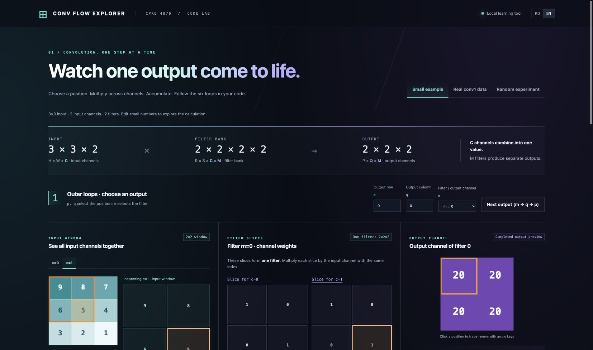

# Conv Flow Explorer

**See how a convolution output is built, one multiply and accumulation at a time.**

[한국어 안내](README.ko.md) · Korean / English interface · No npm dependencies

A local, interactive learning tool connecting tensor shapes to the original CPRE 487 lab code. Select an output position and filter, inspect channel slices, and follow the `p → q → m → r → s → c` loops from bias initialization to ReLU.



## Quick start

After this repository is published:

```bash
git clone https://github.com/devjwk/conv-flow-explorer.git
cd conv-flow-explorer
python3 run.py --offline
```

Requires **Python 3.9+**. On Windows, use `py -3 run.py` if needed. The command picks a random seed and opens a local browser at port 8787. Stop the server with **Ctrl+C**. No Python packages, Node.js, or C++ compiler are needed for this mode.

To clone the public lab repositories and rebuild the included data:

```bash
python3 run.py
```

This mode also requires **Git**. It clones `devjwk/cpre487lab2` through `cpre487lab5` into `sources/` and reuses existing checkouts without pulling or resetting. Lab 1 is currently private and is not required to run this tool. An available C++17 compiler is used for an optional native reference; compilation can be skipped with `--no-native`.

## Explore

| Mode | What to study |
| --- | --- |
| Small example | Editable 3×3×2 input and two 2×2×2 filters; first output is 20 |
| Real conv1 data | Original 64×64×3 input, 5×5×3×32 weights and 60×60×32 output |
| Random experiment | Seeded 4×4×3 input, three 2×2×3 filters and editable values |

- Choose `p`, `q`, and `m`; inspect any input channel `c`.
- Step forward/backward, autoplay, or finish all products for one output.
- Observe the input window, matching filter slice, running sum, array addresses, and highlighted code.
- Read original Lab 2–5 excerpts to connect float32 convolution to integer arithmetic and FPGA MAC units.
- Switch **KO / EN** in the header. Language changes preserve edited values, selection, and calculation progress. The choice is saved in the browser. Use `?lang=en` or `?lang=ko` for an explicit language.

Channel tabs only change the inspected channel. Every input channel still contributes to the output. The output map is a completed preview; the workbench traces one selected output.

## Reproduce an experiment

```bash
python3 run.py --offline --seed 4870
python3 run.py --port 0                  # choose an available local port
python3 run.py --existing-root ..        # reuse local cpre487lab2..5 checkouts
python3 run.py --prepare-only            # prepare data without starting a server
```

Random generation uses `xorshift32-v1`, with seeds from 1 to 4294967295. The same seed gives the same initial tensors: input 0–9, weights −2–2, bias −3–3. Manual edits are not encoded in the seed; applying it again restores the initial values. Random filters are study examples, not trained models.

The static page can also be opened directly from `dist/index.html`; keep all files in `dist/` together. Browser verification was performed over local HTTP.

## Code and data provenance

| Repository | Connection |
| --- | --- |
| [Lab 1](https://github.com/devjwk/cpre487lab1) (private) | TensorFlow training/data context; no Lab 1 files are bundled |
| [Lab 2](https://github.com/devjwk/cpre487lab2) | `computeNaive`, original float32 tensors, bias and ReLU |
| [Lab 3](https://github.com/devjwk/cpre487lab3) | Original VHDL multiply/accumulate pipeline excerpt |
| [Lab 4](https://github.com/devjwk/cpre487lab4) | Original integer convolution excerpt |
| [Lab 5](https://github.com/devjwk/cpre487lab5) | Original input patch sharing and `macGroup` call excerpt |

Bundled data comes from Lab 2: `data/image_0.bin`, `data/model/conv1_weights.bin`, `data/model/conv1_biases.bin`, and `data/image_0_data/layer_0_output.bin`. Byte counts and SHA-256 hashes are recorded in [the data manifest](validation/data-manifest.json).

Input layout is **HWC**, weights **RSCM**, output **PQM**. Stride 1, no padding, batch 1. Source excerpts retain their original text and line numbers. Lab checkouts, machine binaries, and local setup records are excluded from Git.

## Numerical checks and limits

The calculation uses `Math.fround` for float32 multiplication and accumulation in the original `r,s,c` order. The native reference calls the original Lab 2 C++ implementation, compiled with `-O0 -ffp-contract=off`.

Recorded checks:

- All **115,200** real conv1 outputs matched the native C++ reference exactly.
- Maximum absolute error against the TensorFlow reference: **2.384185791015625e-7**.
- All 27 outputs for each seed **4870, 4871, 4294967295** matched native C++ exactly.

See [real-data verification](validation/verification.json) and [random verification](validation/random-verification.json). To regenerate native checks, install a C++17 compiler and Node.js:

```bash
python3 run.py --prepare-only
node tools/verify.cjs
node tools/verify_random.cjs
```

Displayed numbers are rounded; calculation uses original float32 values. Channel partial sums are an explanatory breakdown, accumulated as JavaScript numbers; the final output is computed from the original single float32 accumulator.

This tool reproduces **Lab 2 float32 conv1**. Lab 3–5 source tabs explain connections; they do not simulate FPGA cycles, AXI handshakes, integer inference, or physical board execution. Python startup has been tested on macOS; Windows/Linux runtime validation is not claimed.

## Project structure

```text
dist/          Static interface, translations, computation, embedded data
run.py         Standard-library launcher and optional lab preparation
tools/         Data exporter, original C++ wrapper, numerical checks, ZIP packager
validation/    Recorded numerical checks and source data manifest
docs/          Interface preview
```

This repository contains the learning interface and selected attributed lab excerpts/data. Original course materials and lab code remain associated with their respective sources; this repository does not assign a new license to them.
